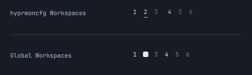
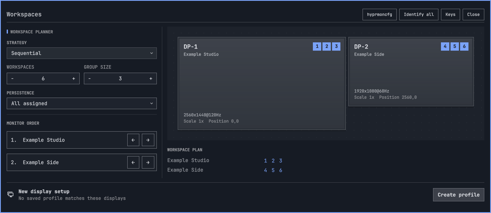

# hyprmoncfg Workspaces 0.1.0

Workspace numbers grouped by your monitors, with the full workspace planner one right-click away.

Install with `omarchy plugin install https://github.com/crmne/omarchy-hyprmoncfg-workspaces`.

*Actual QML components rendered with synthetic data in an isolated display.*

## New

- **Numbers follow your monitor layout.** Compact groups such as `1 2 3   4 5 6` use Omarchy's normal number size and spacing. Click a number to focus its actual screen, or scroll within a monitor's group.
- **Empty assigned workspaces stay visible.** [hyprmoncfg 1.26.0](https://github.com/crmne/hyprmoncfg/releases/tag/v1.26.0) supplies the plan over a read-only connection. Live workspace locations take precedence when a monitor is unplugged.
- **Configure from the picker.** [Panel 2.11.0](https://github.com/crmne/omarchy-hyprmoncfg/releases/tag/v2.11.0) supplies just its Workspaces page, including strategy, group size, monitor order and Apply/Save controls. Its hyprmoncfg button opens the full display editor from that editor's own icon.
- **Guided setup when something is missing.** Install, enable or update the companion panel through Omarchy's normal interactive flow, then use its existing daemon installation and service controls.

## Known limitations

- Positive numeric workspaces are shown. Named and special workspaces remain accessible through Hyprland's normal controls.
- Without the companion panel, the live overview remains available. Older or stopped daemons provide existing workspaces rather than the full saved plan.
- This widget does not change workspace ownership or shortcuts. Pair it with a global workspace plan; choose planner Off and Omarchy's stock widget for monitor-local numbering.

## What's tested

Model tests cover multi-monitor and stacked layouts, rotation, scaling, mirrors, unplugging and high workspace IDs. Setup tests cover the installation stages; the production service survives ten isolated socket closures and reconnects. Installation commands were tested with a fake host, without reinstalling desktop packages.

## Thanks

Thanks to the Omarchy contributors for the shared UI components and plugin system, and users who requested monitor-ordered workspace navigation.

**Full changelog**: https://github.com/crmne/omarchy-hyprmoncfg-workspaces/commits/v0.1.0
