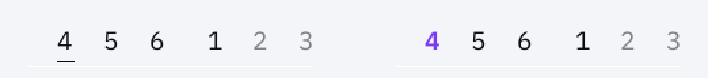

# hyprmoncfg Workspaces 0.2.0

An option to mark the focused workspace with your theme's accent colour instead of an underline.

Install with `omarchy plugin install https://github.com/crmne/omarchy-hyprmoncfg-workspaces`.

*The widget in a live bar with the Chat With Work Light theme, before and after turning the option on.*

## New

- **Accent the focused workspace.** Set `"accentFocused": true` in the widget's entry in `~/.config/omarchy/shell.json` to show the focused workspace's number in your theme's accent colour and semibold instead of underlining it. Keyboard selection keeps its underline. It's off by default, so nothing changes until you turn it on.

## What's tested

The runtime test checks the colour and weight on the live workspace buttons with the option on and off, against the installed Omarchy 4.5 shell, and the 11 model tests pass.

## Thanks

Thanks to the Omarchy contributors for the shared bar components this builds on.

**Full changelog**: https://github.com/crmne/omarchy-hyprmoncfg-workspaces/compare/v0.1.0...v0.2.0
