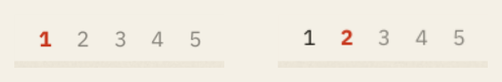

# hyprmoncfg Workspaces 0.3.0

With hyprmoncfg's Per display workspaces, each bar now shows only its own screen's workspaces, numbered 1-10, and works like Omarchy's own workspace widget.

Install with `omarchy plugin install https://github.com/crmne/omarchy-hyprmoncfg-workspaces`.

*The laptop's bar and the external display's bar. The external display is showing its workspace 2, which Hyprland numbers 12.*

## New

- **Per display mode, like Omarchy's widget.** When the active profile uses hyprmoncfg's Per display strategy, each bar shows its own screen's workspaces: 1 to 5, then any higher ones in use, then any visiting from an unplugged screen after a small gap. The workspace each screen is showing is highlighted, and slot 10 reads as 0, as on the keyboard. Clicking a number switches the way Omarchy does, scrolling moves along that bar only, and right-click still opens the workspace planner. Other strategies keep the grouped view of every screen.
- **Works before Omarchy 4.5 too.** hyprmoncfg's daemon tells the widget which block of workspaces each screen owns, so it doesn't read Omarchy's state, and the same bar works where hyprmoncfg runs per-display workspaces itself.
- **Fewer workspaces per screen.** With hyprmoncfg set to fewer than five workspaces per display, the bar shows only that many.
- **Scroll sideways.** A sideways swipe or a tilted wheel over the numbers moves to the next or previous workspace, as scrolling up and down does.

## Changed

- **`accentFocused` sets the number in bold.** It was semibold, which read too close to the other numbers.

## Requirements

Per display mode needs hyprmoncfg [1.30.0](https://github.com/crmne/hyprmoncfg/releases/tag/v1.30.0) or newer. With an older daemon, the widget keeps the grouped view.

## What's tested

19 model tests pass, and the runtime test drives the per-display row against the installed Omarchy 4.5 shell: slot labels, the highlight, guests, clicks through Omarchy and by number, scrolling both ways, and the return to the grouped view. The bars were checked live on a laptop with an external display. Sideways scrolling was not tried with a real touchpad.

## Thanks

Thanks to the Omarchy contributors for the stock workspace widget this mode follows.

**Full changelog**: https://github.com/crmne/omarchy-hyprmoncfg-workspaces/compare/v0.2.0...v0.3.0
